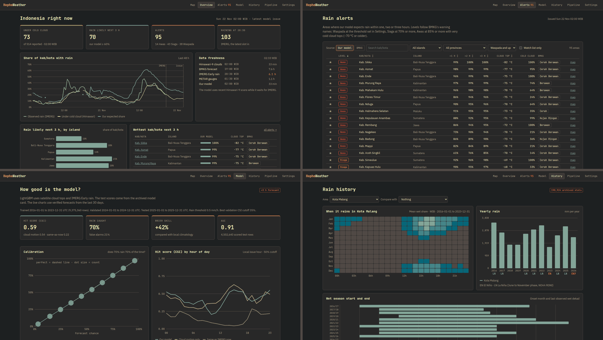
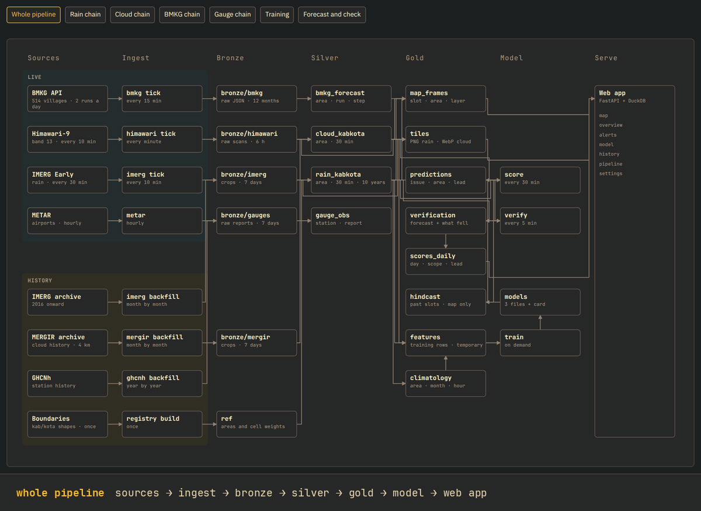

# HephaWeather

dumb weather prediction of 514 kab/kota in indonesia. just showcasing big data pipeline processing. in no way the prediction made here is totally accurate. weather prediction is a very complex system, and the data we process is limited. doing full-blown weather processing will probably need a very powerful computer. not mentioning the availability of public data that is hard to get.

live at [hephaweather.farhankf.my.id](https://hephaweather.farhankf.my.id). for real forecasts and warnings, use [BMKG](https://www.bmkg.go.id).

## The Pipeline

The data moves through three Parquet layers, and DuckDB reads them for the API.

| Layer | What it holds |
|---|---|
| Bronze | Raw files as they arrive: Himawari-9 scans (kept 6 h), IMERG crops and METAR reports (7 days), BMKG JSON (12 months) |
| Silver | One row per kab/kota per 30-min slot: rain and cloud tops since 2016, BMKG forecast steps, gauge reports |
| Gold | Forecasts, verification, daily scores, climatology, map frames and tiles |

- **140.5 billion satellite grid values** read so far: 10.9 years of IMERG (190,924 half-hourly grids of 86,400 cells) and MERGIR (189,936 frames of 652,905 cells).
- **Training:** Spark builds 9.4 million rows per lead from 2016 to 2023, and LightGBM learns from them. The test set is every hour of 2025 for every kab/kota, 4.5 million rows per lead.
- **Live:** 1,542 forecasts every 30 minutes (514 kab/kota × 3 leads). A runner with two job lanes and a FastAPI + DuckDB API run in Docker Compose on a 4 GB server. Training stays on the dev machine.

Built with Python 3.12, Parquet, DuckDB, PySpark, LightGBM, OpenCV optical flow, satpy, FastAPI, MapLibre GL and Docker Compose.

## Data Sources

| Source | What we take | How often, how late | Used for |
|---|---|---|---|
| [NASA IMERG Early Run](https://doi.org/10.5067/GPM/IMERG/3B-HH-E/07) (GPM_3IMERGHHE V07) | Satellite rain estimate on a 0.1° grid, cropped to Indonesia | Every 30 min, about 5 h late | The truth for training and scoring, and recent rain as a feature |
| [NASA GPM_MERGIR](https://doi.org/10.5067/P4HZB9N27EKU) | Infrared cloud-top temperature on a 4 km grid | Every 30 min, 2016 to October 2026 | The cloud history to train on |
| [Himawari-9](https://registry.opendata.aws/noaa-himawari/) AHI band 13, NOAA on AWS | Infrared cloud-top temperature, three full-disk segments | Every 10 min, ready about 13 min after the scan starts | Live cloud features and cloud motion |
| [BMKG forecast API](https://data.bmkg.go.id/prakiraan-cuaca/) | The official 3-hourly forecast for one village in each kab/kota | About 2 runs a day, checked every 15 min | The baseline to beat |
| [METAR](https://aviationweather.gov/data/api/) (aviationweather.gov), [GHCNh](https://www.ncei.noaa.gov/products/global-historical-climatology-network-hourly) (NOAA NCEI) | Airport rain reports | Hourly | A check of satellite rain against gauges |
| [geoBoundaries](https://www.geoboundaries.org/) gbOpen IDN ADM2, [wilayah.id](https://wilayah.id/) | Kab/kota boundaries and Kemendagri codes | Once | The 514 areas |
| [NOAA CPC RONI](https://www.cpc.ncep.noaa.gov/products/analysis_monitoring/enso/roni/) | The El Niño and La Niña index | Updated by hand | ENSO phases on the History page |
| [Natural Earth](https://www.naturalearthdata.com/) | Land of the neighbouring countries | Once | The map background |

Forecast data: BMKG (Badan Meteorologi, Klimatologi, dan Geofisika). Himawari-9 data is produced by JMA and distributed by NOAA. IMERG: Huffman, Stocker, Bolvin, Nelkin and Tan, NASA GES DISC, doi:10.5067/GPM/IMERG/3B-HH-E/07. MERGIR: Janowiak, Joyce and Xie, NASA GES DISC, doi:10.5067/P4HZB9N27EKU. Boundaries: geoBoundaries (CC BY 3.0 IGO), from BPS, WFP and OCHA ROAP. HephaWeather is not affiliated with or endorsed by BMKG, NASA, NOAA or JMA.

## Docs

- [Architecture](docs/architecture.md): data flow, live cycle, code map
- [Data](docs/data.md): every dataset, its layout, columns and retention
- [Model](docs/model.md): target, features, training, baselines, test and live scores
- [Operations](docs/operations.md): setup, environment, schedules, locks, recovery
- [Deployment](docs/deploy.md): run it yourself with `docker compose up -d`
- [API](docs/api.md): routes and responses

The images above come from [`docs/media/capture.py`](docs/media/capture.py), which records them from the live site.
