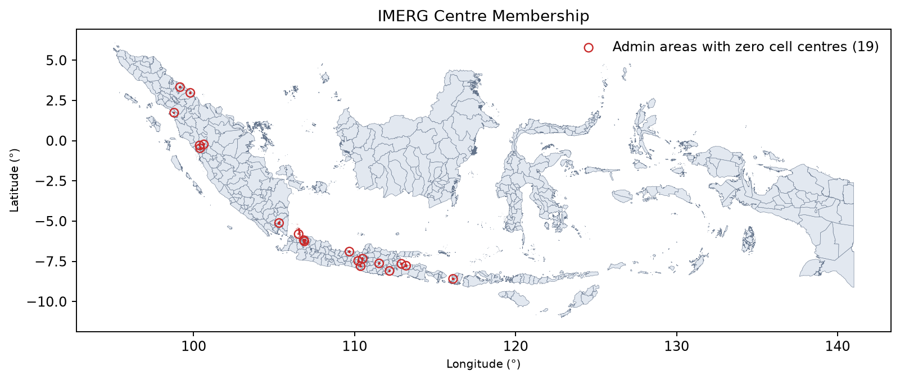
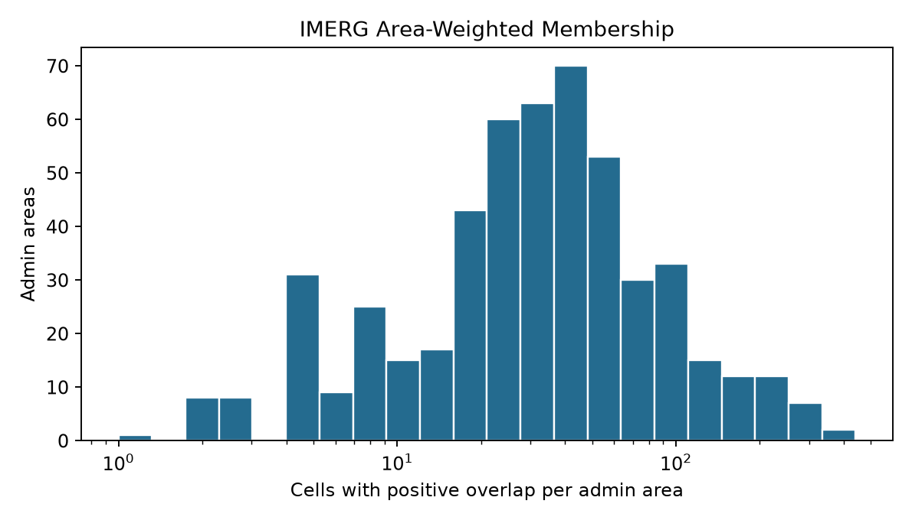

# IMERG Grid Membership Methods

Run on 2026-11-19 at 22:09:00 UTC.

**Question**  
Does centre membership cover every kabupaten and kota on the IMERG 0.1° grid, and how much does overlap weighting change the mean rain rate?

**Method**  
Joined the 514 admin rows in `dim_area.parquet` to the full-resolution polygons by `geo_name` and `shapeName`. Used the 480 × 180 IMERG crop with cell centres at 94.05–141.95° E and 11.45° S–6.45° N, with longitude varying fastest in the cell index.

| Method | Membership and Weight |
|---|---|
| A. Centre | Centre strictly inside the polygon, weight 1 |
| B. Any Overlap | Cell intersects the polygon, including boundary-only contact, weight 1 |
| C. Area-Weighted | Cell has positive intersection area, weight equal to the fraction of the cell covered |

Used a Shapely 2 STRtree to find intersecting cells and vectorised intersections to compute partial weights in lon/lat degrees. The area check summed each fraction times the cell's spherical area, computed as R² Δλ (sin φₙ − sin φₛ) with R = 6371.0072 km and angles in radians. Compared that sum with the EPSG:6933 area stored in `dim_area.area_km2`.

Queried CMR for the newest IMERG Early title and fetched its DAP4 crop. Transposed the rain array from lon × lat to lat × lon. Excluded negative and non-finite rain values, then normalised the method weights over the valid cells. Compared areas with a mean under both A and C.

## Results

CMR returned the 2026-11-19 16:30 UTC slot, `GPM_3IMERGHHE.07:3B-HHR-E.MS.MRG.3IMERG.20261119-S163000-E165959.0990.V07C.HDF5`. The crop contained 86,400 valid rain cells. [Full Run Data](results/01_membership_methods.json)

| Method | Areas with Zero Cells | Min Cells | Median Cells | Max Cells |
|---|---:|---:|---:|---:|
| A. Centre | 19 | 0 | 16 | 358 |
| B. Any Overlap | 0 | 1 | 32.5 | 441 |
| C. Area-Weighted | 0 | 1 | 32.5 | 441 |

| C Area Check and Runtime | Result |
|---|---:|
| Median absolute area error | 0.4433% |
| Max absolute area error | 0.4492% |
| Areas with absolute error over 2% | 0 |
| Cell and index construction plus C weights for all 514 areas | 7.32 s |

Across one 0.1° cell in the crop, cos(latitude) changed by at most 0.00034647 (0.03536% relative). This bounds the variation in the spherical area scale within a cell when computing the overlap fraction in degrees.

| Absolute Rain Difference Between A and C | Result |
|---|---:|
| Areas compared | 495 |
| Median | 0.0008 mm/h |
| 90th percentile | 0.0425 mm/h |
| Max | 0.7029 mm/h |

### Ten Largest Rain Differences

| Admin Area | A (mm/h) | C (mm/h) | Absolute Difference (mm/h) |
|---|---:|---:|---:|
| Kota Ternate | 0.0000 | 0.7029 | 0.7029 |
| Kabupaten Nias Utara | 0.9240 | 1.3741 | 0.4501 |
| Kota Bogor | 1.0500 | 0.6164 | 0.4336 |
| Kota Depok | 0.3100 | 0.6962 | 0.3862 |
| Kota Binjai | 0.0000 | 0.3388 | 0.3388 |
| Kabupaten Bintan | 0.8442 | 0.5622 | 0.2820 |
| Kota Padangsidimpuan | 0.5800 | 0.3628 | 0.2172 |
| Kabupaten Batang | 1.7083 | 1.4946 | 0.2137 |
| Kabupaten Pringsewu | 2.2733 | 2.0754 | 0.1979 |
| Kabupaten Toba | 0.3683 | 0.2057 | 0.1627 |

### Ten Smallest Admin Areas

| Admin Area | Reference Area (km²) | A Cells | C Cells |
|---|---:|---:|---:|
| Kabupaten Administrasi Kepulauan Seribu | 10.78 | 0 | 20 |
| Kota Sibolga | 10.86 | 0 | 2 |
| Kota Magelang | 17.87 | 0 | 2 |
| Kota Mojokerto | 20.21 | 1 | 1 |
| Kota Padang Panjang | 21.09 | 0 | 2 |
| Kota Bukittinggi | 23.83 | 0 | 3 |
| Kota Yogyakarta | 32.91 | 0 | 3 |
| Kota Blitar | 33.37 | 0 | 3 |
| Kota Madiun | 34.62 | 0 | 3 |
| Kota Pasuruan | 38.93 | 0 | 2 |

## Observations

- Centre membership omitted 19 admin areas, including nine of the ten smallest. C produced a rain estimate for all 514 areas. Of the areas omitted by A, 8 had positive rain under C in this crop.
- B and C selected the same cells for every admin area in this run.
- Kota Ternate had the largest change. Its mean went from 0.0000 to 0.7029 mm/h for this slot.

## Conclusion

Use C, area-weighted overlap, for production. It covered all 514 admin areas and kept the area error below 0.45% for each area.
