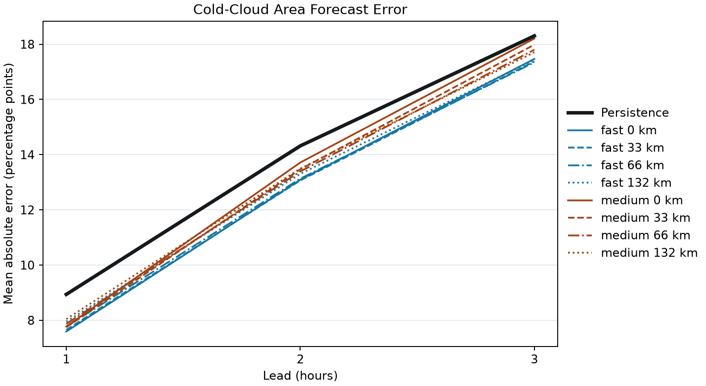
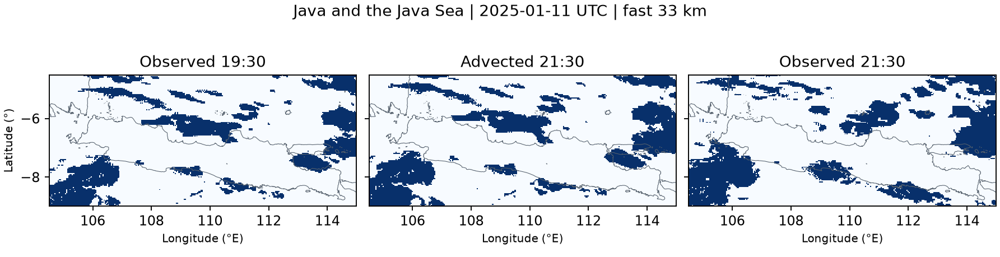

# Optical-Flow Settings for Cold-Cloud Advection

## Question

Does optical-flow advection predict where cold cloud will be 1 to 3 hours ahead better than persistence? Which DIS preset and smoothing distance give the lowest area error on the MERGIR grid?

## Method

Used 168 hourly MERGIR crops from 2025-01-08 00:00 through 2025-01-14 23:30 UTC, with two half-hour frames per crop. Cold pixels had valid brightness temperatures below 233 K. Compared persistence with fast and medium DIS at Gaussian smoothing scales of 0, 33, 66, and 132 km. DIS estimated displacement from the previous frame to the current frame. Each forecast advected the current mask with that displacement multiplied by 2, 4, or 6. The first frame used persistence for all settings because the preceding frame falls outside the experiment window.

For pixel CSI, thresholded the advected mask at 0.5 and divided hits by the union of forecast and observed cold pixels, using pixels with valid temperatures at both the analysis and verification times. For area MAE, used the MERGIR membership weights and rounded the observed cold shares and interpolated advected shares to whole percentages, as in production. Compared the same admin areas for all settings. An area needed valid observations at both times. Averaged each score over frames after calculating the area MAE across available areas for each frame.

Area MAE skill is one minus the ratio to persistence MAE. CSI difference is the forecast CSI minus persistence CSI. Ranked motion settings by the mean area MAE across the three leads. Timed field generation on one OpenCV thread and reported the median of the frame-mean speeds over currently cold pixels.

## Results

The 495 × 1319 crop had a nominal pixel size of 4.04 km. Both metrics used all 334, 332, and 330 frame pairs at +1, +2, and +3 h. Invalid temperatures accounted for 530,814 pixel observations (0.24%). Each lead excluded four area pairs from the 514 admin areas. [Full Run Data](results/03_flow_settings.json)

### Area MAE and Skill

Each cell gives MAE in percentage points and skill versus persistence in parentheses.

| Setting | +1 h | +2 h | +3 h |
|---|---:|---:|---:|
| Persistence | 8.938 (+0.0%) | 14.317 (+0.0%) | 18.302 (+0.0%) |
| fast 0 km | 7.592 (+15.1%) | 13.091 (+8.6%) | 17.467 (+4.6%) |
| fast 33 km | 7.652 (+14.4%) | 13.068 (+8.7%) | 17.377 (+5.1%) |
| fast 66 km | 7.769 (+13.1%) | 13.130 (+8.3%) | 17.344 (+5.2%) |
| fast 132 km | 7.947 (+11.1%) | 13.306 (+7.1%) | 17.433 (+4.7%) |
| medium 0 km | 7.775 (+13.0%) | 13.715 (+4.2%) | 18.206 (+0.5%) |
| medium 33 km | 7.749 (+13.3%) | 13.470 (+5.9%) | 17.983 (+1.7%) |
| medium 66 km | 7.870 (+11.9%) | 13.392 (+6.5%) | 17.800 (+2.7%) |
| medium 132 km | 8.045 (+10.0%) | 13.495 (+5.7%) | 17.710 (+3.2%) |

### Pixel CSI and Difference

Each cell gives mean CSI and the difference from persistence in parentheses.

| Setting | +1 h | +2 h | +3 h |
|---|---:|---:|---:|
| Persistence | 0.4964 (+0.0000) | 0.3576 (+0.0000) | 0.2782 (+0.0000) |
| fast 0 km | 0.5837 (+0.0873) | 0.4152 (+0.0576) | 0.3106 (+0.0324) |
| fast 33 km | 0.5820 (+0.0856) | 0.4159 (+0.0583) | 0.3122 (+0.0340) |
| fast 66 km | 0.5775 (+0.0810) | 0.4143 (+0.0567) | 0.3133 (+0.0351) |
| fast 132 km | 0.5692 (+0.0728) | 0.4088 (+0.0512) | 0.3120 (+0.0338) |
| medium 0 km | 0.5779 (+0.0815) | 0.3947 (+0.0371) | 0.2894 (+0.0112) |
| medium 33 km | 0.5804 (+0.0840) | 0.4017 (+0.0441) | 0.2953 (+0.0171) |
| medium 66 km | 0.5761 (+0.0797) | 0.4053 (+0.0477) | 0.3011 (+0.0229) |
| medium 132 km | 0.5675 (+0.0711) | 0.4034 (+0.0458) | 0.3050 (+0.0268) |

### Runtime and Speed

Over 333 analysis frames, raw DIS averaged 14.45 ms/frame for fast and 70.59 ms/frame for medium. Field time includes DIS and Gaussian smoothing. Image preparation, advection, and scoring are outside the field timing.

| Setting | Field Time (ms/frame) | Median Cold-Cloud Speed (km/h) |
|---|---:|---:|
| Persistence | — | 0.00 |
| fast 0 km | 14.45 | 34.66 |
| fast 33 km | 29.64 | 34.23 |
| fast 66 km | 49.29 | 33.46 |
| fast 132 km | 85.09 | 32.18 |
| medium 0 km | 70.59 | 39.51 |
| medium 33 km | 86.29 | 38.25 |
| medium 66 km | 106.06 | 36.84 |
| medium 132 km | 143.03 | 34.78 |

Dark blue marks cold cloud. The example starts at 19:30 UTC on 11 January 2025. Of the eligible +2 h forecasts, its initial cold coverage in the Java crop was closest to 20%.

## Observations

All eight motion settings lowered area MAE and raised pixel CSI at each lead. Fast DIS led on both metrics at each lead, with 0 km smoothing at +1 h, 33 km at +2 h, and 66 km at +3 h. Fast/33 km lowered mean MAE by 0.018 percentage points versus unsmoothed fast DIS, which had the shortest field time.

## Conclusion

Use `preset: fast` and `sigma_km: 33` in `config/settings.yaml` based on this week. Mean area MAE across leads fell from 13.021 percentage points with the current medium/66 km setting to 12.699 with fast/33 km, a reduction of 0.322 points (2.47%). The reductions at +1, +2, and +3 h were 0.218, 0.324, and 0.424 points. Compared with persistence, fast/33 km lowered area MAE by 14.4%, 8.7%, and 5.1% and raised CSI by 0.086, 0.058, and 0.034 at those leads.
