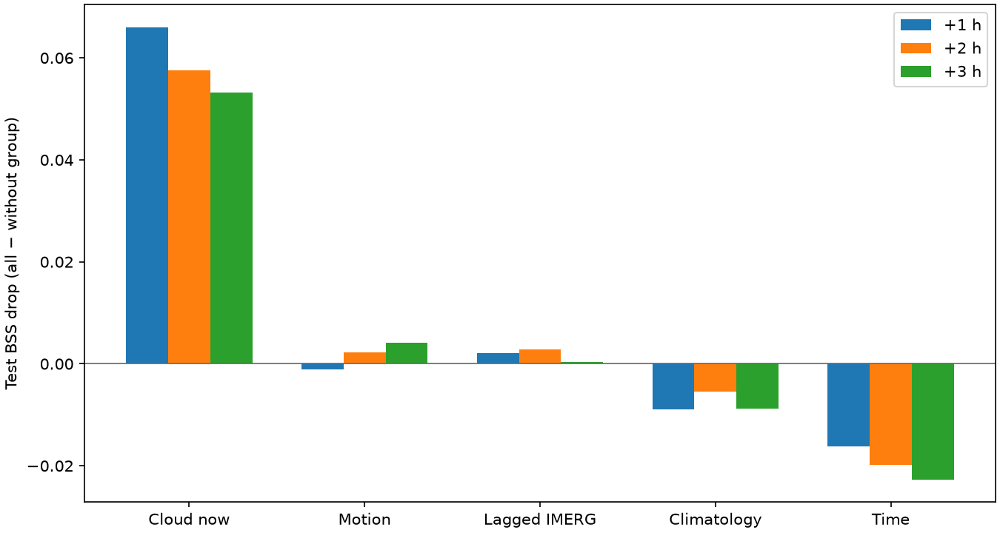
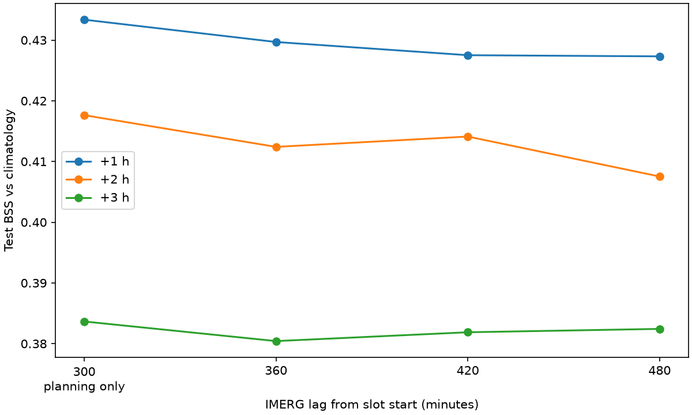

# Feature Ablation and IMERG Lag Sensitivity

## Questions

Which feature groups carry January 2025 test skill at +1, +2, and +3 h? How does that skill change when the latest usable IMERG slot is older?

## Method

Used the existing January feature table for ablation. Its `t` and `imerg_slot` columns show a 360-minute lag. Reused the CLI split dates in UTC (train January 1–21, validation January 22–25, test January 26–31), LightGBM parameters, seed 42, and validation log-loss early stopping with 100 rounds of patience. Each lead predicts whether any half-hour slot in its target window reaches 0.5 mm/h. All runs used raw model probabilities with no isotonic calibration.

Trained the full feature set, five variants that each omit one group, and five variants that each use one group with island and area. The time group contains hour and day-of-year encodings. The climatology group contains historical wet share and the lead-specific rain probability. Used the January 1–21 climatology as the Brier skill score (BSS) reference for every run, including when both climatology features were omitted. As in the CLI, fitting used rows with a target and scoring also required a finite climatology probability. Selected each model's critical success index (CSI) cutoff on validation and applied it to test.

Rebuilt the table at 300, 360, 420, and 480 minutes with the package feature builder. Fitted the full feature set for each lead at each lag, checked that row keys, targets, and climatology matched the ablation table, and deleted each rebuilt table after use. Lag is measured from issue time back to slot start. The 300-minute planning case uses a slot that would still be unavailable at the assumed live latency, so it is included only to measure the effect of the correction to 360 minutes. [IMERG Lag Decision](../decision-log.md)

## Results

Each fit used 518,112 training rows. Scores at each lead use 98,688 validation rows for cutoff selection and 140,284 test rows. The run took 481.75 s for 45 fits, four rebuilds, and both figures. [Full Run Data](results/04_ablation.json)

### Feature Ablation

| Lead | Variant | Brier | BSS | AUC | CSI | Validation Cutoff |
|---:|:---|---:|---:|---:|---:|---:|
| +1 h | `all` | 0.1198 | 0.4297 | 0.9006 | 0.6003 | 0.4165 |
| +1 h | `minus_cloud_now` | 0.1337 | 0.3637 | 0.8738 | 0.5683 | 0.4001 |
| +1 h | `minus_motion` | 0.1196 | 0.4308 | 0.9005 | 0.6007 | 0.4025 |
| +1 h | `minus_imerg_lag` | 0.1203 | 0.4276 | 0.8992 | 0.5962 | 0.4005 |
| +1 h | `minus_climatology` | 0.1180 | 0.4386 | 0.9058 | 0.6077 | 0.4502 |
| +1 h | `minus_time` | 0.1164 | 0.4459 | 0.9035 | 0.6062 | 0.3428 |
| +1 h | `only_cloud_now` | 0.1174 | 0.4410 | 0.9031 | 0.6055 | 0.3519 |
| +1 h | `only_motion` | 0.1337 | 0.3635 | 0.8699 | 0.5662 | 0.3235 |
| +1 h | `only_imerg_lag` | 0.2039 | 0.0295 | 0.6843 | 0.3570 | 0.1928 |
| +1 h | `only_climatology` | 0.2076 | 0.0121 | 0.6623 | 0.3688 | 0.2317 |
| +1 h | `only_time` | 0.2132 | -0.0148 | 0.6401 | 0.3560 | 0.3050 |
| +2 h | `all` | 0.1335 | 0.4124 | 0.8894 | 0.6271 | 0.3979 |
| +2 h | `minus_cloud_now` | 0.1466 | 0.3549 | 0.8660 | 0.6041 | 0.4480 |
| +2 h | `minus_motion` | 0.1340 | 0.4102 | 0.8886 | 0.6290 | 0.4232 |
| +2 h | `minus_imerg_lag` | 0.1342 | 0.4096 | 0.8885 | 0.6267 | 0.4215 |
| +2 h | `minus_climatology` | 0.1323 | 0.4179 | 0.8947 | 0.6332 | 0.4248 |
| +2 h | `minus_time` | 0.1290 | 0.4322 | 0.8941 | 0.6352 | 0.3347 |
| +2 h | `only_cloud_now` | 0.1307 | 0.4249 | 0.8915 | 0.6307 | 0.3448 |
| +2 h | `only_motion` | 0.1448 | 0.3629 | 0.8656 | 0.6072 | 0.3309 |
| +2 h | `only_imerg_lag` | 0.2218 | 0.0239 | 0.6778 | 0.4187 | 0.2136 |
| +2 h | `only_climatology` | 0.2245 | 0.0122 | 0.6605 | 0.4370 | 0.2778 |
| +2 h | `only_time` | 0.2302 | -0.0128 | 0.6407 | 0.4272 | 0.3534 |
| +3 h | `all` | 0.1446 | 0.3804 | 0.8770 | 0.6446 | 0.4354 |
| +3 h | `minus_cloud_now` | 0.1570 | 0.3272 | 0.8548 | 0.6209 | 0.4645 |
| +3 h | `minus_motion` | 0.1456 | 0.3763 | 0.8746 | 0.6394 | 0.4102 |
| +3 h | `minus_imerg_lag` | 0.1447 | 0.3801 | 0.8763 | 0.6412 | 0.3984 |
| +3 h | `minus_climatology` | 0.1426 | 0.3892 | 0.8828 | 0.6515 | 0.4497 |
| +3 h | `minus_time` | 0.1393 | 0.4031 | 0.8821 | 0.6484 | 0.3173 |
| +3 h | `only_cloud_now` | 0.1418 | 0.3926 | 0.8778 | 0.6457 | 0.3398 |
| +3 h | `only_motion` | 0.1541 | 0.3399 | 0.8557 | 0.6263 | 0.3315 |
| +3 h | `only_imerg_lag` | 0.2286 | 0.0207 | 0.6743 | 0.4750 | 0.1754 |
| +3 h | `only_climatology` | 0.2304 | 0.0130 | 0.6600 | 0.4908 | 0.3096 |
| +3 h | `only_time` | 0.2364 | -0.0126 | 0.6406 | 0.4829 | 0.4046 |

A positive bar shows the BSS lost when the group is removed. A negative bar shows a BSS gain.

### IMERG Lag Sensitivity

| Lag (min) | Lead | Brier | BSS | AUC | CSI | Validation Cutoff |
|---:|---:|---:|---:|---:|---:|---:|
| 300 | +1 h | 0.1190 | 0.4334 | 0.9016 | 0.6020 | 0.4235 |
| 300 | +2 h | 0.1324 | 0.4176 | 0.8902 | 0.6302 | 0.4043 |
| 300 | +3 h | 0.1439 | 0.3837 | 0.8769 | 0.6436 | 0.4118 |
| 360 | +1 h | 0.1198 | 0.4297 | 0.9006 | 0.6003 | 0.4165 |
| 360 | +2 h | 0.1335 | 0.4124 | 0.8894 | 0.6271 | 0.3979 |
| 360 | +3 h | 0.1446 | 0.3804 | 0.8770 | 0.6446 | 0.4354 |
| 420 | +1 h | 0.1203 | 0.4275 | 0.9001 | 0.6002 | 0.4197 |
| 420 | +2 h | 0.1332 | 0.4141 | 0.8894 | 0.6282 | 0.4051 |
| 420 | +3 h | 0.1443 | 0.3819 | 0.8765 | 0.6422 | 0.4038 |
| 480 | +1 h | 0.1203 | 0.4273 | 0.8999 | 0.5975 | 0.4010 |
| 480 | +2 h | 0.1347 | 0.4075 | 0.8886 | 0.6244 | 0.4032 |
| 480 | +3 h | 0.1441 | 0.3824 | 0.8765 | 0.6418 | 0.3981 |

The rebuilt 360-minute runs reproduced the ablation baseline exactly. BSS changes below use unrounded scores.

| Lag Change (min) | +1 h | +2 h | +3 h |
|---|---:|---:|---:|
| 300 to 360 | -0.0037 | -0.0052 | -0.0032 |
| 360 to 420 | -0.0022 | +0.0017 | +0.0015 |
| 360 to 480 | -0.0024 | -0.0049 | +0.0020 |

## Observations

Removing current-cloud features cut BSS by 0.0660, 0.0575, and 0.0532 at +1, +2, and +3 h. Current cloud with geography was the strongest single-group fit at each lead and exceeded the full model by 0.0113 to 0.0124 BSS. Motion with geography retained 0.3399 to 0.3635 BSS. Its incremental contribution in the full model ranged from −0.0011 to +0.0041. Lagged IMERG added 0.0003 to 0.0028 BSS in the full model. Removing climatology or time improved BSS at all three leads. Time with geography scored below the climatology reference at all three leads.

Correcting the planning lag from 300 to 360 minutes lowered BSS by 0.0032 to 0.0052. Extending 360 to 480 minutes lowered BSS by 0.0024 at +1 h and 0.0049 at +2 h, and raised it by 0.0020 at +3 h. Only +1 h BSS declined at each increment.

## Conclusion

Current-cloud features carried most of the skill in January 2025. Motion carried substantial skill with geography and added little with current cloud present. Lagged IMERG made a small incremental contribution. The longer lags cost at most 0.0049 BSS relative to 360 minutes in this run, with small gains at some leads. One month represents one weather regime. Treat the ranking as a sanity check for the full 10-year run.
