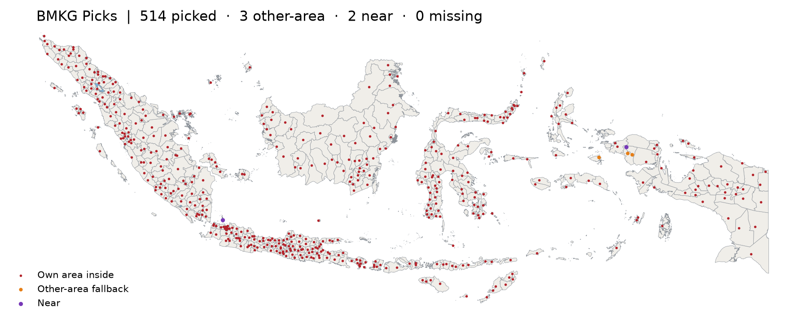

# Step 1: Area Registry

Date: 2026-11-19/20. Status: done, awaiting review.

## What Was Built

- `nowcast registry boundaries`: the full-resolution geoBoundaries IDN ADM2 file at the pinned commit (159 MB, 519 features) in `ref/`, with its sha256.
- `nowcast registry dim-area`: `ref/dim_area.parquet`, 519 rows (codes, island, time zone, centroid and area from the full-resolution polygons in EPSG:6933).
- `nowcast registry membership --grid imerg|mergir`: area-weighted overlap on both grids (method chosen in experiment 01). MERGIR cell centres were fetched once from OPeNDAP and kept in `config/geo/mergir_grid.json`.
- `nowcast registry neighbours`: border neighbours, plus the 6 nearest centroids for the 30 areas with no land border.
- `nowcast registry bmkg-candidates` and `bmkg-picks`: one BMKG point per kab/kota from a sweep of all kecamatan.
- `nowcast registry check [--wilayah]`: all the checks below.
- Experiments: `docs/experiments/01-membership-methods.md` (centre rule leaves 19 areas empty; area-weighted overlap covers all 514).

## Done When

`uv run nowcast registry check --wilayah` on 2026-11-20:

```
PASS dim_area rows=519 admin=514 non-admin=5 (Danau, Danau Toba, Hutan, Waduk Cirata, Wadung Kedungombo)
PASS imerg_cells min=1 median=32.5
PASS imerg_weights max_error=0.4492% worst=Kota Padang Panjang
PASS mergir_cells min=5 median=169
PASS mergir_weights max_error=0.4535% worst=Kota Payakumbuh
PASS bmkg_picks picked=514 own_inside=509 other_area=3 near=2 missing=0 invalid_outside=0 unknown_adm4=0 other_area_to_representative=[Maybrat (25.212 km), Raja Ampat (24.844 km), Sorong Selatan (16.994 km)] near_to_polygon=[Kepulauan Seribu (0.643 km), Tambrauw (7.652 km)]
PASS neighbours admin=514 missing=0
PASS wilayah matched=29/29 expected=29
```

Pick map:



## Measured Facts

| Item | Value |
|---|---|
| IMERG membership | 25,478 rows, 1 to 441 cells per area, 198 KB |
| MERGIR membership | 145,362 rows, 5 to 2,961 cells per area, 1.0 MB |
| Area error of the weights | 0.44% to 0.45% for every area, on both grids |
| BMKG candidate sweep | 7,285 kecamatan in 2 h 17 min at 55 requests/min; 7,203 accepted, 82 failed (BMKG 404) |
| Pick distance to representative point | median 5.0 km, max 82 km |

The area error is the same 0.44% everywhere because the cell areas are computed on the authalic sphere while `area_km2` comes from the WGS84 ellipsoid (EPSG:6933). Near the equator the ellipsoid's area per square degree is about 0.45% smaller (a²(1−e²)/R² = 0.9955). It does not affect weighted means.

## Differences From the Plan

- **BMKG codes in Papua Barat Daya.** All 82 failed kecamatan answer 404 from BMKG. 76 of them are in province 96 (Papua Barat Daya, created in 2022), and BMKG rejects many of its desa codes even when up to 30 villages per kecamatan are tried. Raja Ampat and Sorong Selatan have no accepted code of their own. BMKG does answer some old Papua Barat codes (for example `92.05.01.2001` gives Waigama, Raja Ampat), but the plan says never to guess codes, so these were not used. **Open question for juan.**
- **Pick fallbacks.** The plan requires every pick inside its polygon. 509 areas meet that. Maybrat, Raja Ampat and Sorong Selatan use another area's candidate that lies inside their polygon. Kepulauan Seribu (tiny islands) and Tambrauw use their own candidate 0.6 km and 7.7 km outside the 2020 polygon.
- **Display vs full-resolution geometry.** The simplified display polygon of Kepulauan Seribu has 91% less area than the full-resolution one (tiny islands dropped). The full-resolution file is used for all computation.
- `ref/` is 160 MB, above the 0.1 GB planned, because of the full-resolution boundaries.
