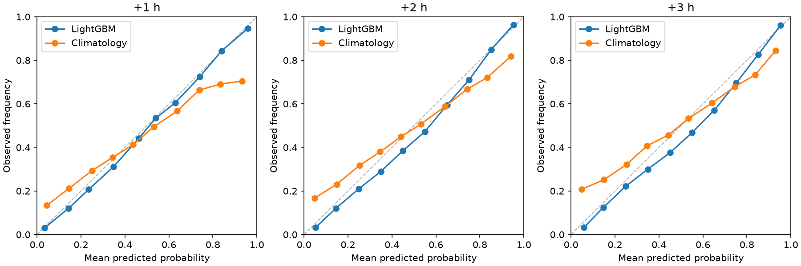
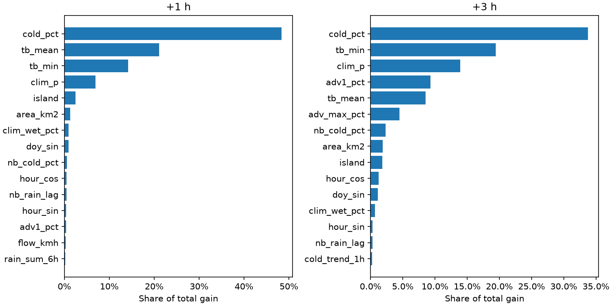

# Step 6: Features and Training

Date: 2026-11-20. Status: done on the sample month, awaiting review. The full 10-year training runs on the server (step 10).

## What Was Built

- `nowcast features climatology` and `nowcast features build` (PySpark local mode): one row per issue slot and admin area, with only data available at the issue time t. Cloud features at t, IMERG at the newest slot whose start is at least `imerg_lag_minutes` (360) before t, neighbour means, local-hour and day-of-year cycles, static fields, the train-period climatology, and targets `y1..y3`.
- `nowcast model train`: one LightGBM classifier per lead, early stopping on validation log loss, optional isotonic calibration, baselines (event climatology, persistence of the lagged IMERG, motion with a CSI-tuned threshold), metrics, figures and `models/<version>/card.json`. `--check-repro` retrains and compares.
- Experiment 04 (`docs/experiments/04-ablation.md`): feature-group ablation and IMERG lag sensitivity.

## Run

Sample month 2025-01, split by date: train 1 to 21, validate 22 to 25, test 26 to 31. Features: 764,832 rows x 35 columns in 121 s, 2.1 GB driver heap. Positive rate 32.6%, 40.3%, 46.4% for +1, +2, +3 h. Model version `20261120T0004Z-3bf0e31`, best iterations 307, 187, 208. Validation reliability was within tolerance for +2 and +3 h; +1 h got an isotonic calibrator.

## Done When

`uv run nowcast model train --keep-features --check-repro` (test set, 140,284 rows per lead, every source on the same rows):

```
lead source       n      base   Brier   BSS     CSI@0.5 CSI@best POD@0.5 FAR@0.5 AUC
+1h  model    140284  0.3379  0.1186  0.4355  0.5821  0.6003  0.6997  0.2241  0.9005
+1h  clim     140284  0.3379  0.2101  0.0000  0.2308  0.3674  0.2850  0.4521  0.6609
+1h  persist  140284  0.3379  0.3574 -0.7011  0.2750  0.3379  0.4013  0.5336      --
+1h  motion   140284  0.3379  0.2550 -0.2138  0.5129  0.5129  0.7949  0.4088      --
+2h  model    140284  0.4152  0.1335  0.4124  0.6274  0.6271  0.7884  0.2456  0.8894
+2h  clim     140284  0.4152  0.2273  0.0000  0.3281  0.4361  0.4323  0.4233  0.6608
+2h  persist  140284  0.4152  0.3913 -0.7219  0.2867  0.4152  0.3788  0.4590      --
+2h  motion   140284  0.4152  0.2508 -0.1034  0.5698  0.5698  0.7998  0.3355      --
+3h  model    140284  0.4749  0.1446  0.3804  0.6444  0.6446  0.8166  0.2466  0.8770
+3h  clim     140284  0.4749  0.2334  0.0000  0.4091  0.4900  0.5566  0.3932  0.6605
+3h  persist  140284  0.4749  0.4202 -0.8003  0.2913  0.4749  0.3636  0.4059      --
+3h  motion   140284  0.4749  0.2657 -0.1382  0.5988  0.5988  0.8350  0.3208      --
Wrote /home/juan/hermes_project/weather/data/models/20261120T0004Z-3bf0e31
repro ok
```

- Brier skill above 0 for all leads: yes (0.44, 0.41, 0.38).
- Retraining from the same data and seed gives the same metrics: `repro ok`.





Top gain features: +1 h `cold_pct` 48%, `tb_mean` 21%, `tb_min` 14%; +3 h `cold_pct` 34%, `tb_min` 19%, `clim_p` 14%, `adv1_pct` 9%.

## Experiment 04 in Short

Removing the cloud-now group costs the most (BSS −0.066, −0.058, −0.053). Motion alone keeps most of the skill but adds little on top of cloud-now. Removing climatology or time-of-day raises BSS on this month, most likely because a 21-day climatology and a diurnal fit learned from one month overfit; the 10-year run must decide. The safe 360-minute lag costs 0.003 to 0.005 BSS against the 300-minute value.

## Differences From the Plan

- The IMERG lag is an offset to the slot start (360 min), not the raw latency (see `docs/decision-log.md`).
- The climatology baseline uses the event probability per lead, not the cell wet share.
- These scores come from one month, one weather regime, with train and test only days apart. They are a sanity check and will drop on the 10-year split.
