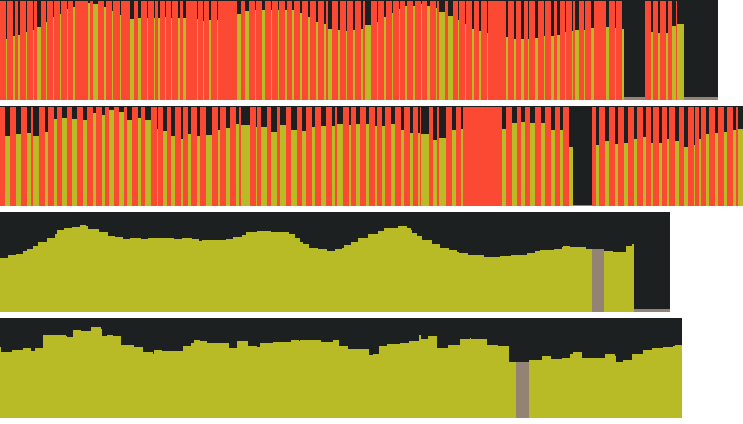
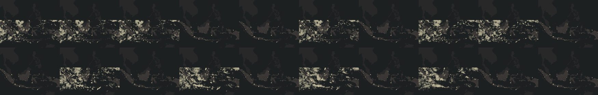
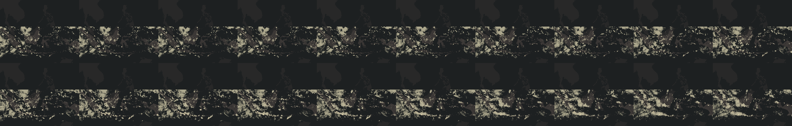

# Step 9: Map Render Fixes

Date: 2026-11-20. Status: fixed in `web/app.js`. The check script is `experiments/07_render_check.py`.

## Result

During play, the cloud layer and the raw rain grid were blank on 73% and 59% of rendered frames. They are blank on 0% now. The raw rain grid shows for all 84 observed slots that have a tile. The 2 slots without a tile show the newest earlier image and say which one. All 7 pages still have 0 console errors and 0 failed requests at 1440 x 900 and 390 x 844 (`experiments/06_web_check.py`).

## Issues, Root Causes and Fixes

| # | Issue | Root cause | Fix |
|---|---|---|---|
| 1 | Cloud layer flickers while playing or moving the slider | `drawRaster` hid the layer at the start of each frame change, then made it visible again only after the tile fetch and `createImageBitmap` finished. Every frame therefore rendered at least once with no image. | The layer stays visible with the previous image until the new image is drawn into the canvas. The next frame's tile is prefetched while playing. |
| 2 | Raw rain grid sometimes does not show | (a) The same hide-then-load path as issue 1, so the grid was blank on many renders during play and slider drags. (b) Two IMERG slots, 2026-11-19 11:00 and 11:30 UTC, have no rain tile, although their bronze granules exist. | (a) As issue 1. (b) A slot without its own tile uses the newest tile up to 2 h older and says so ("No raw rain image archived for this time. Showing the one from 17:30 WIB."). Past 2 h the grid is hidden and the note says no image is archived. |
| 3 | Cloud gap | Himawari scans from 2026-11-19 22:10 to 23:50 UTC are in bronze but have no cloud tile, so 3 frames had no clouds. | The same 2 h fallback with a note. |
| 4 | Map areas flash to "no data" on the 60 s refresh | The refresh cleared all frame data, applied the frame, and only then fetched new frames. | Frames are keyed by slot time, so the old values keep drawing. Each layer is replaced when its new frames arrive (`frameStamps`). |
| 5 | Page scrolls to the top on each refresh | The refresh called `show()`, which calls `window.scrollTo(0, 0)`. The archive stamp changes about every 2 min (frames rebuild), so a scrolled page jumped up that often. | The refresh calls `renderView(view)`, which re-renders without changing the scroll position. |
| 6 | Alerts page and alert count do not update | The refresh never reloaded `/api/alerts`. | The refresh calls `loadAlerts()`. |
| 7 | Misleading raw-grid note after the last IMERG slot | For frames after the last observation, the note said no image was archived, although the banner already said IMERG is pending. | The note is hidden for pending frames, and the banner explains them. |

## Evidence

The check script reads the WebGL drawing buffer in each map `render` event. It counts cloud pixels (bright and grey, over the dark BMKG no-data fill) or rain pixels (the rain colours) in a part of the map that no card covers. A render is blank when its frame has a tile but the render drew under 25% of the 90th-percentile share. The `before` run serves the committed `app.js` through a Playwright route.

| Check (1440 x 900, play from frame 0) | Before | After |
|---|---:|---:|
| Cloud: blank renders on frames with a tile | 486 of 663 (93 frames) | 0 of 622 |
| Raw rain: blank renders on frames with a tile | 428 of 724 (83 frames) | 0 of 669 |
| Raw rain, stepped slot by slot: slots with a tile that did not show | 0 of 84 | 0 of 84 |
| Raw rain, slots without a tile | hidden, no image | earlier image shown, with a note |
| Refresh on the map: renders with no area values | 1 of 18 | 0 of 10 |
| Refresh on the overview: scroll position | 164 → 0 | 164 → 164 |
| Console errors | 0 | 0 |

Stepped slot by slot with 250 ms waits, the old code showed every tile. The fault appears only when frames change faster than a tile loads, as in play and slider drags.

Share of cloud or rain pixels per render while playing. The rows are: cloud before, rain before, cloud after, rain after. Red marks a blank render, and grey marks a frame without its own tile:



Screenshots taken in sequence during cloud play. Before (blank frames between cloudy ones):



After:



Light theme and 390 x 844 screenshots from `06_web_check.py` were checked by eye. Clouds, the drawer and the slider render as in the mockup.

## Reproduce

```
uv run python experiments/07_render_check.py after
git show cc33c19:web/app.js > /tmp/app-before.js
uv run python experiments/07_render_check.py before --app /tmp/app-before.js
uv run python experiments/06_web_check.py
```

Output goes to `data/tmp/render-check/<label>/`. The refresh test waits 64 s; `--skip-refresh` leaves it out.

## Open Points

- The missing tiles are a pipeline gap, not a web gap. `nowcast gold tiles` renders missing tiles from bronze and should fill both gaps. It was not run here because this task does not write to `data/`.
- At 1440 x 900 the left card column is 14 px taller than its box (753 px of 739) because of the extra "No data" legend row and the longer credits, so it scrolls slightly. The mockup fits exactly.
- The area drawer's details (`/api/areas/<id>`) are not refetched on the refresh. Values that come from frames update, but the cloud-top line gains new slots only when the area is opened again.
