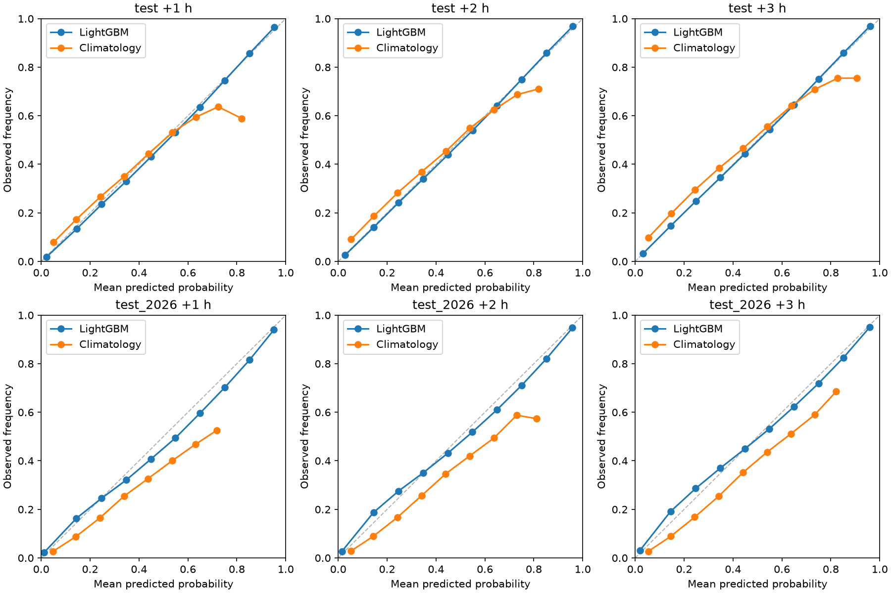
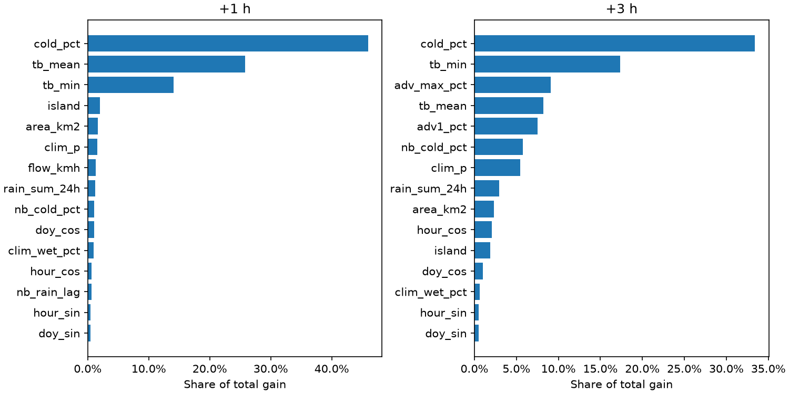

# Step 10: Full Runs on the Dev Machine

Date: 2026-11-20. Status: done, awaiting review. By juan's decision the 10-year backfills and the full training ran on the dev machine (8 cores, 7.7 GB RAM, 30 Mbps line), not on the server. Containers, the server move and the Cloudflare Tunnel are not part of this run.

## Summary

| Item | Result |
|---|---|
| IMERG Early backfill | 2016-01 to 2026-10, 189,936 of 189,936 slots, 11.9 GB download, 3 h 50 min |
| MERGIR backfill | 2016-01 to 2026-10, 189,936 of 189,936 frames, 76.6 GB download, 6 h 22 min |
| Silver size | rain 169 MB (cap 500 MB), cloud 408 MB (cap 600 MB) |
| `DATA_ROOT` | 1.13 GB of the 8 GB budget |
| Feature table | 22,143,120 rows, 524 MB, 9 min, deleted after training |
| Model | `20261120T1329Z-a2f52f2`, trained in 32 min, peak RSS 4.6 GB |
| Test 2025 BSS (+1, +2, +3 h) | 0.476, 0.456, 0.423 |
| Test 2026-03..10 BSS | 0.438, 0.426, 0.406 |

## Download Speed

A benchmark on 2016-01 granules (one day per level, the project's own download functions) measured each IMERG crop request at about 2 s at every parallel level. IMERG was bound by NASA's response time, and MERGIR at 16 or more requests was bound by the line (2.6 to 2.8 MB/s against 3.5 MB/s measured from a 50 MB Cloudflare download).

| Source | Parallel | MB/s | Request median | Projected per month |
|---|---|---|---|---|
| IMERG | 8 | 0.20 | 2.0 s | 6.5 min |
| IMERG | 16 | 0.42 | 1.9 s | 3.4 min |
| IMERG | 24 | 0.40 | 2.1 s | 3.2 min, one dropped connection |
| MERGIR | 8 | 1.91 | 2.5 s | 4.3 min |
| MERGIR | 16 | 2.57 | 4.2 s | 3.4 min |
| MERGIR | 24 | 2.75 | 4.8 s | 3.0 min |

Changes made for the run:
- The NASA parallel cap is 16 (`NASA_PARALLEL=16` for backfills; the default and the live tick stay at 8).
- The MERGIR backfill downloads the next month while it processes the current one. One download is in flight at a time, and months are processed in order.
- The IMERG backfill held the `state/` directory lock for its whole run, which would have blocked the live scorer (shared lock) and skipped every live IMERG tick. It now holds that lock only while a month is written, and a separate lock file keeps two backfills apart.

## IMERG Backfill

```
NASA_PARALLEL=16 setsid nohup uv run --frozen nowcast imerg backfill --start 2016-01 --end 2026-10 \
  > data/state/imerg_backfill.log 2>&1 < /dev/null &
```

- 02:53 to 06:43 UTC. Months took 78 to 218 s, about 2 min on average. 2025-01 was already done and was skipped.
- The run stopped once at 2024-09: NASA returned 504 and read timeouts from 05:50 to 06:01 UTC (61 of the run's 67 retries), and 2 of 1,440 granules failed after 4 attempts. The restart reused the 1,438 crops on disk and fetched the other 2 in 9 s.
- Gap reports (`nowcast imerg gaps --month` for all 130 months, `data/state/imerg_gaps/`): 0 missing slots, 514 rows in every slot, 0 null area-slots.
- Versions: `V07B` for 178,320 slots up to 2026-03-03 23:30 UTC, `V07C` for 11,616 slots from 2026-03-04 00:00 UTC. The archive switches 3 days after the announced 1 March date.
- Indonesia-box wet share per month: 4.7% (2019-09) to 35.3% (2024-12).

## MERGIR Backfill

Started by a waiter script once every IMERG month was done, so the two never ran together:

```
NASA_PARALLEL=16 setsid nohup uv run --frozen nowcast mergir backfill --start 2016-01 --end 2026-10 \
  > data/state/mergir_backfill.log 2>&1 < /dev/null &
```

- 06:44 to 13:06 UTC. With the overlap, a month took about as long as its download (2016-02: 79 s waiting, 75 s processing, 153 s elapsed). Over all months: 3.3 h waiting for downloads, 3.0 h processing.
- The run stopped once at 2024-10: NASA's authentication returned 401 for about 2 minutes at 11:48 UTC. A supervisor restarted it 5 minutes later; the token stayed valid.
- Gap reports (`nowcast mergir gaps --month` for all 130 months, `data/state/mergir_gaps/`): 0 missing frames, 514 rows in every slot. The highest invalid-cell share was 5.35% (2017-07).
- Median cold-cloud speed per month: median 28.4 km/h, range 16.0 to 45.5 km/h (v6 measured about 30 km/h).

## Storage

`uv run nowcast disk` after both backfills:

```
silver/rain_kabkota      168.830
silver/cloud_kabkota     408.085
bronze/himawari          316.817
ref                      160.378
...
TOTAL 1.128708 GB of 8 GB
```

Bronze IMERG and MERGIR crops were deleted month by month (`bronze/mergir` 0 MB after the run). Download in total: 88.5 GB, against the planned 95 GB.

## Training

Config change only (`config/settings.yaml`, commit `21ca403`): climatology and train 2016-01-01..2023-12-31, valid 2024, test 2025, `test_2026` 2026-03-01..2026-10-31, issue times every 60 min, and 25% of the days of each train month (`model.sample_days`, seed 42). The trainer loads and scores one split at a time, so only train and valid are in memory together.

```
uv run --frozen nowcast features climatology
uv run --frozen nowcast features build --start 2016-01-01 --end 2026-10-31
uv run --frozen nowcast model train --figure-prefix step-10
```

| Stage | Runtime | Output | Memory |
|---|---|---|---|
| Climatology | 81 s | 148,032 rows (514 x 12 x 24) | not measured |
| Feature build | 539 s | 22,143,120 rows x 35 columns, 524 MB | Java peak 3.9 GB RSS, at least 1.3 GB free |
| Training | 1,910 s | 3 models, 11 MB | peak 4.6 GB RSS, at least 1.17 GB free |

- Train kept 760 of 2,922 days. Rows per lead: train 9,375,360, valid 4,514,976, test 4,502,640, `test_2026` 3,022,320 (+1 h).
- The table also holds 2026-01 and 2026-02, which belong to no split and are not read.
- Target positive rate over the table: 20.2%, 25.6%, 30.0% for +1, +2, +3 h (sample month: 32.6%, 40.3%, 46.4%).
- Validation BSS: 0.480, 0.460, 0.427. Validation reliability was within tolerance for every lead, so no isotonic calibration was fitted.
- Best iteration was 2,000 for every lead, which is the `n_estimators` cap: validation log loss was still falling when training stopped.
- The sample-month climatology was copied to `data/tmp/climatology-2025-01-sample.parquet` before the rebuild.

### Test Table

All sources are scored on the same rows. CSI@best uses the threshold that maximised CSI on 2024.

```
split     lead source       n      base   Brier   BSS     CSI@0.5 CSI@best POD@0.5 FAR@0.5 AUC
test      +1h  model   4502640  0.2271  0.0834  0.4755  0.5672  0.5813  0.6786  0.2245  0.9325
test      +1h  clim    4502640  0.2271  0.1589  0.0000  0.0990  0.2961  0.1077  0.4497  0.7090
test      +1h  persist 4502640  0.2271  0.2794 -0.7576  0.2066  0.2271  0.3202  0.6321      --
test      +1h  motion  4502640  0.2271  0.1978 -0.2443  0.4615  0.4615  0.7461  0.4526      --
test      +2h  model   4502640  0.2898  0.1002  0.4561  0.5851  0.5995  0.6961  0.2141  0.9198
test      +2h  clim    4502640  0.2898  0.1843  0.0000  0.1765  0.3506  0.2019  0.4166  0.7074
test      +2h  persist 4502640  0.2898  0.3144 -0.7064  0.2158  0.2898  0.2986  0.5622      --
test      +2h  motion  4502640  0.2898  0.2071 -0.1241  0.5145  0.5145  0.7572  0.3839      --
test      +3h  model   4502640  0.3400  0.1153  0.4227  0.5902  0.6052  0.7036  0.2146  0.9054
test      +3h  clim    4502640  0.3400  0.1997  0.0000  0.2417  0.3935  0.2874  0.3970  0.7067
test      +3h  persist 4502640  0.3400  0.3451 -0.7284  0.2182  0.3400  0.2833  0.5129      --
test      +3h  motion  4502640  0.3400  0.2203 -0.1034  0.5379  0.5379  0.7544  0.3478      --
test_2026 +1h  model   3022320  0.1214  0.0564  0.4379  0.4819  0.4983  0.5829  0.2643  0.9387
test_2026 +1h  clim    3022320  0.1214  0.1003  0.0000  0.0881  0.2194  0.1003  0.5802  0.7583
test_2026 +1h  persist 3022320  0.1214  0.1701 -0.6954  0.1458  0.1214  0.2390  0.7279      --
test_2026 +1h  motion  3022320  0.1214  0.1211 -0.2070  0.4023  0.4023  0.6711  0.4989      --
test_2026 +2h  model   3021806  0.1608  0.0712  0.4262  0.4891  0.5125  0.5834  0.2484  0.9303
test_2026 +2h  clim    3021806  0.1608  0.1240  0.0000  0.1546  0.2633  0.1900  0.5471  0.7565
test_2026 +2h  persist 3021806  0.1608  0.1963 -0.5826  0.1535  0.1608  0.2214  0.6662      --
test_2026 +2h  motion  3021806  0.1608  0.1365 -0.1006  0.4415  0.4415  0.6710  0.4365      --
test_2026 +3h  model   3021292  0.1934  0.0837  0.4062  0.4898  0.5192  0.5830  0.2461  0.9211
test_2026 +3h  clim    3021292  0.1934  0.1410  0.0000  0.2122  0.2966  0.2766  0.5230  0.7561
test_2026 +3h  persist 3021292  0.1934  0.2193 -0.5554  0.1554  0.1934  0.2087  0.6217      --
test_2026 +3h  motion  3021292  0.1934  0.1532 -0.0866  0.4548  0.4548  0.6608  0.4068      --
Wrote /home/juan/hermes_project/weather/data/models/20261120T1329Z-a2f52f2
```

### Reliability



On 2025 the model lies on the diagonal for every lead. On 2026-03..10 it is slightly too high above 0.4 and slightly too low near 0.15. Climatology there is too high at every bin, because the 2016-2023 climatology does not know the drier V07C estimates and the dry-season months that dominate this set.

### Feature Importance



Top gain: +1 h `cold_pct` 46%, `tb_mean` 26%, `tb_min` 14%; +2 h `cold_pct` 41%, `tb_min` 19%, `tb_mean` 13%, `adv1_pct` 6%; +3 h `cold_pct` 33%, `tb_min` 17%, `adv_max_pct` 9%, `tb_mean` 8%, `adv1_pct` 7%, `nb_cold_pct` 6%, `clim_p` 5%.

### Compared With the Sample-Month Model

| Lead | Sample BSS | Full BSS (2025) | Sample AUC | Full AUC (2025) | Sample CSI@0.5 | Full CSI@0.5 (2025) |
|---|---|---|---|---|---|---|
| +1 h | 0.435 | 0.476 | 0.901 | 0.933 | 0.582 | 0.567 |
| +2 h | 0.412 | 0.456 | 0.889 | 0.920 | 0.627 | 0.585 |
| +3 h | 0.380 | 0.423 | 0.877 | 0.905 | 0.644 | 0.590 |

- Brier skill and AUC are higher on the 10-year model, on a test year it never saw. The sample model was tested on days 26 to 31 of its own training month.
- CSI is lower because the base rate is lower (22.7% against 33.8% at +1 h); CSI favours frequent events.
- `clim_p` fell from 7 to 14% of gain to 2 to 5%. The 21-day sample climatology was noisy, as experiment 04 suspected; an 8-year climatology is smooth, and cloud features carry the signal.
- At +3 h the motion features (`adv_max_pct` + `adv1_pct`) carry 17% of gain, against 14% in the sample model.

## Live Scoring With the New Model

The live scorer takes the newest folder in `models/`, so the new version took over with no config change. The 14:00 UTC slot was the first one scored with it (fast loop, `nowcast live score`):

```
2026-11-20T14:13:10Z INFO nowcast.sources.himawari: Himawari scan 2026-11-20T14:00:00+00:00 latency_min=11.91 model_slot=True
2026-11-20T14:13:24Z INFO nowcast.model.score: Scored t=2026-11-20T14:00:00+00:00 issued_at=2026-11-20T14:13:24.823510+00:00 delay=13.41 min rows=1542
```

`gold/predictions` for that slot: 1,542 rows, all `model_version = 20261120T1329Z-a2f52f2`, 514 per lead, no null probabilities. Mean `prob_pct` 17.9, 22.3, 27.4 for +1, +2, +3 h. The live loops ran during the whole run; the narrower IMERG lock kept live scoring unblocked.

## Differences From the Plan

- The full runs ran on the dev machine, not the server (juan, 2026-11-20). No containers or server move in this step.
- NASA parallelism was 16 for the backfills, not 8 (benchmark above). IMERG and MERGIR never ran at the same time.
- `test_2026` starts on 2026-03-01 as planned, but the archive switches to V07C on 2026-03-04, so its first 3 of 245 days are V07B.
- The model reached the 2,000-tree cap on every lead. A longer run or a higher learning rate may still gain skill; tune on validation only.
- `--check-repro` was not run on the full data (it doubles the 32 min); reproducibility was shown on the sample month and on a scratch copy with four splits.
- Each run stops when a granule fails after its retries. Both stops were short NASA-side outages, and restarts were cheap because finished months and downloaded crops are kept.
